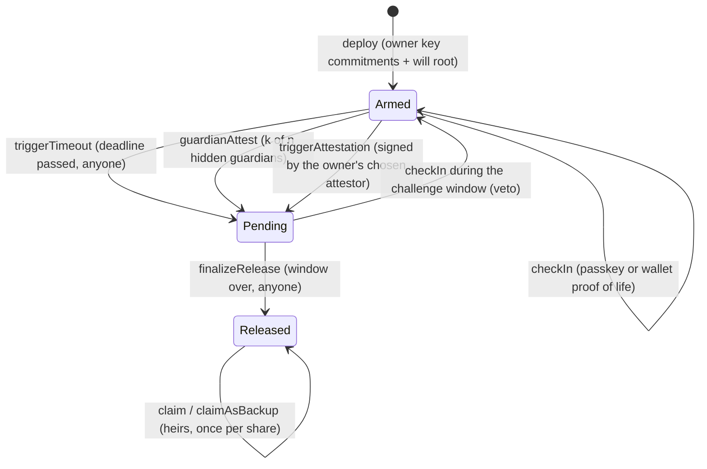
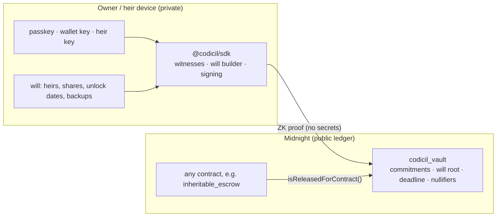

# Codicil

[](https://github.com/Evangel90/Codicil/actions/workflows/ci.yml)
[](LICENSE)

**On every other blockchain, your will is public. Codicil is an inheritance protocol where your
heirs, their shares and your proof that you're alive all stay private, enforced by
zero-knowledge proofs on [Midnight](https://midnight.network).**

Self-custodied crypto is lost when its owner dies. Existing on-chain "dead man's switches" publish
who the heirs are, what each gets and when the owner is active, which makes families targets.
Codicil keeps the will private. The owner proves they are alive with **Face ID / Touch ID** (a
passkey) or a **Cardano wallet**, verified inside a ZK circuit. If they stop, or if hidden
guardians or a trusted attestor report their death, heirs can claim their share privately once the
owner has had a chance to veto.

> **Status (Wave 3, in progress):** the vault contract, SDK and web app are built and tested. That
> covers passkey and wallet check-ins, multi-heir wills with tranches and backup heirs, hidden k-of-n
> guardians, the attestation trigger and the cross-contract hook: 139 tests, every contract call
> checked against its ZK circuit, plus browser tests that check in with Chrome's real WebAuthn. The
> Preprod deployment is next. See [What changed this Wave](#what-changed-this-wave).
> Demo video and deck: *coming*.

## Judge quickstart

Requirements: Node 22+ and the [Compact toolchain](https://docs.midnight.network/) (compiler 0.36.1).

```bash
git clone https://github.com/Evangel90/Codicil.git && cd Codicil
curl --proto '=https' --tlsv1.2 -LsSf \
  https://github.com/midnightntwrk/compact/releases/download/compact-v0.5.3/compact-installer.sh | sh
compact update 0.36.1
npm ci
npm run compile     # compiles the Compact contracts (--skip-zk: seconds, not minutes)
npm test            # contracts, SDK and app, about 10 s
npm run dev         # the web app at http://localhost:5173
```

### Try the demo

`npm run dev`, then open **http://localhost:5173** (use exactly this address: passkeys are bound to
the site they were made on, and the vault was compiled for it). The demo runs the **real vault
contract in your browser** on a simulated chain with a clock you can fast-forward. Only proof
generation and network fees are skipped.

1. **Seal a vault** with Face ID / Touch ID (or a demo key if your device has neither).
2. **I'm alive**: your passkey signs the check-in, and the circuit verifies the signature, the
   website and the Face ID flag.
3. Switch to **Dr. Mensah**, then **Sarah Lin**, and report a death: two of three guardians start a
   7-day countdown. Switch back to the owner and cancel it.
4. **Skip to the deadline**, start the countdown, skip the challenge window, **release**.
5. Optional: **Change the will** and re-seal it with Face ID, then open an **heir letter** (what
   you would print or send each heir; it is reissued whenever the will changes).
6. Switch to **Ben** and claim 30%. Try **Kofi** (backup heir: must wait 30 days) and **Cleo** (her
   share unlocks on her 18th birthday).
7. Open the **Privacy lens** at any point: the will beside the public ledger.

`npm run compile:full` also generates the proving keys (several minutes; sizes in
[docs/VALIDATION.md](docs/VALIDATION.md)).

## How it works





- **Owner** registers a passkey and/or a Cardano wallet. Only salted *commitments* to the keys go
  on-chain.
- **Will**: each heir entry (key commitment, share, unlock date, optional backup heir, salt) is a
  leaf of a Merkle tree. Only the root is on-chain. Each heir privately receives their own leaf
  and path.
- **Check-in** signs `aliveDigest(vault, nextDeadline, nonce)`. The circuit checks the signature
  against the committed key without revealing it. Replays fail because the nonce moves.
- **Release**: the countdown starts after a missed deadline (anyone can trigger it), when k of n
  hidden guardians vote, or with an attestation from a trusted signer. In every case the owner can
  veto during the challenge window, and any check-in voids earlier votes and attestations. After
  the window the estate is snapshotted.
- **Claim**: an heir proves their leaf is in the will and that they hold its key. A nullifier
  stops double claims without revealing which heir claimed. Backup heirs share the same nullifier,
  so at most one of the pair is ever paid.

Repository layout:

| Path | What |
|---|---|
| [`contracts/src/codicil_vault.compact`](contracts/src/codicil_vault.compact) | The vault |
| [`contracts/src/lib/WebAuthn.compact`](contracts/src/lib/WebAuthn.compact) | Passkey (WebAuthn) verification in-circuit |
| [`contracts/src/lib/Cip30.compact`](contracts/src/lib/Cip30.compact) | Cardano CIP-30 wallet signature verification in-circuit |
| [`contracts/src/inheritable_escrow.compact`](contracts/src/inheritable_escrow.compact) | Example: any contract becomes inheritable with one call |
| [`contracts/test/`](contracts/test) | Simulator, property and cross-contract tests |
| [`sdk/src/`](sdk/src) | Witnesses, will builder, passkey/wallet conversion, error catalogue |
| [`codicil-spike/`](codicil-spike) | Phase 0 validation spike (gates V1–V15) |
| [`tools/webauthn-capture/`](tools/webauthn-capture) | Page used to capture real passkey and wallet signatures |
| [`docs/`](docs) | Validation results, design decisions, error catalogue |

## Midnight integration

| Midnight feature | Used for | Where |
|---|---|---|
| Dual ledger: public ledger plus private witnesses | Only commitments, the will root, deadlines and nullifiers are public | [`codicil_vault.compact:59`](contracts/src/codicil_vault.compact#L59), witnesses [`:85`](contracts/src/codicil_vault.compact#L85) |
| `persistentCommit` (salted commitments) | Hide owner and heir public keys | [`codicil_vault.compact:125`](contracts/src/codicil_vault.compact#L125) |
| Merkle proofs (`merkleTreePathRootNoLeafHash`) | Prove "my share is in the will" without saying which | [`codicil_vault.compact:364`](contracts/src/codicil_vault.compact#L364) |
| Nullifiers (`Set<Bytes<32>>`) | One claim per share, one vote per guardian per round, unlinkable | `claimNullifiers`, `guardianNullifiers` in [`codicil_vault.compact`](contracts/src/codicil_vault.compact) |
| **P-256** `secp256r1EcdsaVerify` (Ledger 9) | Face ID / Touch ID passkey check-ins; attestor signatures | [`lib/WebAuthn.compact:99`](contracts/src/lib/WebAuthn.compact#L99) |
| **SHA-256** `persistentHash` over raw bytes | Rebuild the WebAuthn signed message in-circuit | [`lib/WebAuthn.compact:96`](contracts/src/lib/WebAuthn.compact#L96) |
| **Ed25519** `ed25519Verify` (Ledger 9) | Cardano wallet (CIP-30) check-ins | [`lib/Cip30.compact:38`](contracts/src/lib/Cip30.compact#L38) |
| **Curve25519** `ecMulGenerator` (Ledger 9) | Heirs prove they hold their key | [`codicil_vault.compact:370`](contracts/src/codicil_vault.compact#L370) |
| **`kernel.caller()`** (Ledger 9) | The integrator hook answers only contracts | [`codicil_vault.compact:350`](contracts/src/codicil_vault.compact#L350) |
| **Cross-contract calls** (Ledger 9) | `inheritable_escrow` asks the vault before paying out | [`inheritable_escrow.compact:49`](contracts/src/inheritable_escrow.compact#L49) |
| **Events** `emit` (Ledger 9) | Heir apps and indexers learn of a release | [`codicil_vault.compact:344`](contracts/src/codicil_vault.compact#L344) |
| Block time (`blockTimeGte` / `blockTimeLt`) | Deadlines, challenge window, tranches | [`codicil_vault.compact:218`](contracts/src/codicil_vault.compact#L218) |
| Unshielded tokens (`receiveUnshielded` / `sendUnshielded`) | Hold the estate, pay heirs | [`codicil_vault.compact:277`](contracts/src/codicil_vault.compact#L277), [`:388`](contracts/src/codicil_vault.compact#L388) |
| Generic modules | Passkey verifier parameterised by the site origin | [`codicil_vault.compact:28`](contracts/src/codicil_vault.compact#L28) |

## What is public and what is private

| Data | Where it lives | Who can see it |
|---|---|---|
| Owner passkey / wallet public key | Private; only a salted commitment on-chain | Owner only |
| Will (heirs, shares, unlock dates, backups) | Private; only the Merkle root on-chain | Owner; each heir learns only their own entry |
| Deadline, phase, counters | Public ledger | Everyone (reveals that *a* vault is alive, not *whose*) |
| Guardian identities and votes | Private; only the Merkle root, threshold and a vote count on-chain | Each guardian knows only themselves |
| Claims | Public nullifier; payout to an address the heir chooses | Everyone sees *that* a share was claimed, not by which heir |
| Payout amount | Public (unshielded transfer) | Everyone. Hiding amounts is on the roadmap ([D4, D8](docs/DECISIONS.md)) |

Threats and mitigations, each linked to the test that demonstrates it: [docs/THREAT_MODEL.md](docs/THREAT_MODEL.md).

Tests check the privacy claims directly: a check-in transcript contains no owner key, salt or
signed digest, and a claim transcript contains no leaf, key commitment or heir key
([`lifecycle.test.ts`](contracts/test/lifecycle.test.ts), [`claims.test.ts`](contracts/test/claims.test.ts)).

## Testing

`npm test` runs, for every circuit, the happy path plus every `assert` triggered on purpose.
**Every successful simulated call is also checked against the compiled ZK circuit** (`zkir`
constraint check, as the Compact compiler's own test suite does), so passing means "a proof for
this call can be generated", not just "the JavaScript ran".

| Suite | What it proves |
|---|---|
| [`auth.test.ts`](contracts/test/auth.test.ts) | Check-ins and will updates via passkey and wallet: replay, wrong deadline, other vault, wrong key, forged signature, other website, Face ID not used, limits, veto |
| [`lifecycle.test.ts`](contracts/test/lifecycle.test.ts) | Deposits, timeout, release, events, what a check-in reveals |
| [`claims.test.ts`](contracts/test/claims.test.ts) | Claims, tranches, backups, exact payout maths, over-allocated wills, malicious payout witness |
| [`properties.test.ts`](contracts/test/properties.test.ts) | fast-check: random wills, estates and claim orders; the owner can always veto |
| [`guardians.test.ts`](contracts/test/guardians.test.ts) | k-of-n threshold, double votes, non-members, stale timestamps, votes voided by check-ins, attestation replay across rounds |
| [`escrow.test.ts`](contracts/test/escrow.test.ts) | Cross-contract hook: two proofs in one transaction |
| [`webauthn-real.test.ts`](contracts/test/webauthn-real.test.ts) | Real Touch ID assertions verified by the vault's own WebAuthn module |
| [`errors.test.ts`](contracts/test/errors.test.ts) | Every contract error has a friendly UI message and is documented |
| [`sdk/test`](sdk/test) | Passkey/wallet format conversion, will builder, witnesses, heir letter encoding |
| [`app/test`](app/test/demo.test.ts) | The whole demo story through the app's own store: check-ins, veto, guardian rounds, release, claims, tranche, backup |
| [`app/e2e`](app/e2e/demo.spec.ts) | In Chrome: create a passkey (virtual authenticator), check in through the real WebAuthn API, guardians, release, claim, privacy lens. `npm run e2e` |

The property tests already found one design flaw, now fixed ([D9](docs/DECISIONS.md)).

## Validation results

Before building, we validated every Midnight primitive Codicil depends on (15 gates; 14 pass,
end-to-end on Preprod is pending). Highlights:

- Real **Touch ID** signatures verify in-circuit. Chrome randomly lengthens the signed browser
  data (in 2 of 5 captures), so the verifier accepts both forms.
- Real **Cardano wallet** `signData` signatures verify in-circuit (119-byte COSE structure).
- We found a Compact compiler crash (exporting a struct containing `Curve25519Point` or
  `Secp256r1Point`) and worked around it.

Full results, key sizes and fallbacks: [docs/VALIDATION.md](docs/VALIDATION.md).
Design decisions: [docs/DECISIONS.md](docs/DECISIONS.md). Error catalogue: [docs/ERRORS.md](docs/ERRORS.md).

## Roadmap

1. End-to-end deployment on Preprod, with the app talking to Lace and the proof server.
2. In the app: writing a will from scratch, and heirs creating their own keys on their own devices.
3. Owner-signed updates to guardians and the attestor; a recovery key.
4. Stretch: unlinkable check-ins, a sealed digital legacy (encrypted letters with keys split among
   guardians), and executor disclosures for courts and tax authorities.

## What changed this Wave

- Phase 0: 15 validation gates, 14 passing, with real passkey and wallet captures.
- Vault contract: passkey and wallet check-ins, will updates, timeout, hidden k-of-n guardians, an
  attestation trigger, veto, release, multi-heir claims with tranches and backup heirs, a payout cap,
  and the cross-contract hook.
- TypeScript SDK with witnesses, will builder, passkey/wallet conversion and an error catalogue.
- Web app with a demo that runs the real contract in the browser: Face ID check-ins, changing the
  will, printable heir letters with QR codes, guardian reports, veto, release, claims and a privacy
  lens. Dark and light themes, works on phones.
- 139 tests with ZK constraint checks, including property tests, plus browser end-to-end tests.
  CI on every push.
- A threat model mapping each threat to the test that covers it.

## License and attribution

Apache License 2.0, see [LICENSE](LICENSE).

Built on [Midnight](https://midnight.network): the [Compact](https://github.com/midnightntwrk/compact)
language and compiler, [`@midnight-ntwrk/compact-runtime`](https://www.npmjs.com/package/@midnight-ntwrk/compact-runtime),
and `@midnightntwrk/zkir-v3` / `@midnightntwrk/onchain-runtime-v4` for constraint checks. The
multi-contract test chain (`contracts/test/support/chain.ts`) is adapted from the Compact
compiler's test-center (Apache-2.0).
