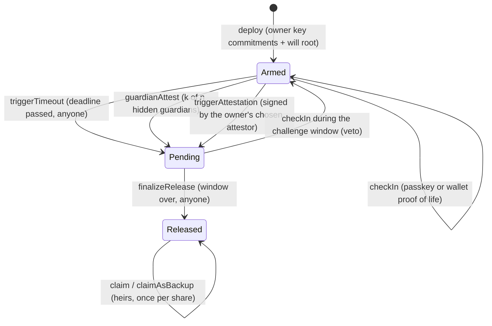
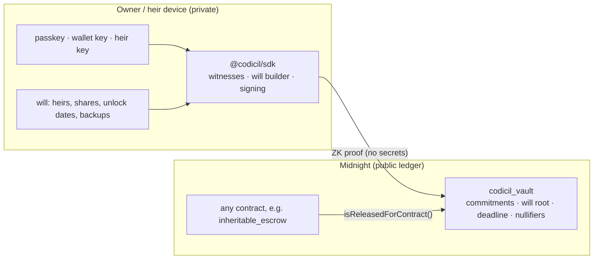

# Codicil

[](https://github.com/Evangel90/Codicil/actions/workflows/ci.yml)
[](LICENSE)

**On every other blockchain, your will is public. Codicil is an inheritance protocol where your
heirs, their shares and your proof that you're alive all stay private, enforced by
zero-knowledge proofs on [Midnight](https://midnight.network).**

Self-custodied crypto is lost when its owner dies. Existing on-chain "dead man's switches" publish
who the heirs are, what each gets and when the owner is active, which makes families targets.
Codicil keeps the will private. The owner proves they are alive with **Face ID / Touch ID** (a
passkey) or a **Cardano wallet**, verified inside a ZK circuit. If they stop, or if hidden
guardians or a trusted attestor report their death, heirs can claim their share privately once the
owner has had a chance to veto.

> **Status (Wave 3, in progress):** the vault contract, SDK and web app are built and tested. That
> covers passkey and wallet check-ins, multi-heir wills with tranches and backup heirs, hidden k-of-n
> guardians, the attestation trigger and the cross-contract hook: 419 tests, every contract call
> checked against its ZK circuit, plus browser tests that check in with Chrome's real WebAuthn. On
> 26 November 2026 the vault ran end to end on **Preprod**: deploy, both kinds of check-in, release,
> a claim and the cross-contract withdrawal ([results](preprod/results/v14-preprod.md), vault
> `4f3b21e1c811…`). The web app now has a **live mode** (`#/app`) in which a person creates and uses
> their own vault on Preview or Preprod through the Lace wallet
> ([how to try it](#try-it-on-a-test-network)); its store and chain code ran that whole story on
> Preview with a wallet built from a seed. It has not yet been run with the Lace extension itself,
> and a check-in from a browser is not yet proven on a network.
> See [What changed this Wave](#what-changed-this-wave).
> Demo video and deck: *coming*.

## Judge quickstart

The full guide, with what to expect at each step and where each rubric item is evidenced:
[docs/JUDGES_QUICKSTART.md](docs/JUDGES_QUICKSTART.md).

Requirements: Node 22+ and the [Compact toolchain](https://docs.midnight.network/) (compiler 0.36.1).

```bash
git clone https://github.com/Evangel90/Codicil.git && cd Codicil
curl --proto '=https' --tlsv1.2 -LsSf \
  https://github.com/midnightntwrk/compact/releases/download/compact-v0.5.3/compact-installer.sh | sh
compact update 0.36.1
npm ci
npm run compile     # compiles the Compact contracts (--skip-zk: seconds, not minutes)
npm test            # contracts, SDK and app, about 10 s
npm run dev         # the web app at http://localhost:5173
```

### Try the demo

`npm run dev`, then open **http://localhost:5173** (use exactly this address: passkeys are bound to
the site they were made on, and the vault was compiled for it). The demo runs the **real vault
contract in your browser** on a simulated chain with a clock you can fast-forward. Only proof
generation and network fees are skipped.

1. **Create a vault** in the eight-step wizard: register Face ID / Touch ID (or a demo key), set the
   shares, the guardian threshold and the timers (or start from a Careful / Balanced / Quick preset).
   Two choices are optional and off by default: a **grace period** (step 5) and a **recovery key**
   (step 6), which is shown once to print or download.
   The review step reads the will back in plain words and flags risky choices. The side panel shows the real heirs root and
   commitments that would go on-chain, recomputed as you edit.
2. **I'm alive**: your passkey signs the check-in, and the circuit verifies the signature, the
   website and the Face ID flag.
   The **Next** line under the demo bar always says whose turn it is, and their button pulses.
3. **Act as** a guardian (Dr. Mensah, then Sarah Lin) and vote: two of three start a 14-day
   challenge window. Switch back to Amara and cancel it.
4. **Skip to deadline**, start the switch, skip the challenge window, **release**. With a grace
   period, the deadline is followed by **Skip the grace period**: until then nobody can start the
   switch, and a check-in is late but fine.
5. Optional: on the **Will** tab, change the will and re-seal it with Face ID, then open an **heir
   letter** (what you would print or send each heir; it is reissued whenever the will changes).
6. Act as heir **Ben**: load his letter (paste it, scan its QR code, or use the demo shortcut). His
   device checks it against the public will fingerprint and spots letters from an older will. Then
   claim his share to a fresh address. Try **Kofi** (backup heir: must wait
   30 days) and **Cleo** (her share unlocks on her 18th birthday).
7. Open the **Savings** tab at any point: a second contract (the compiled `inheritable_escrow`)
   holds tokens for Ben and calls the vault before it pays. Before the release it refuses with its
   own error, `vault not released`; after, the same button pays. The screen shows the one line of
   Compact that makes any contract inheritable.
8. On the owner's **Settings** tab: add, remove or replace **guardians**, change how many must
   agree, or name an attestor, all in one update signed like a check-in. It starts a new voting
   round and is locked once a countdown has started. With a recovery key, play **"I lost my
   passkey"**: start a recovery with the saved key, then either skip the delay and finish it (the new
   passkey works, the old one is refused) or check in as Amara, which cancels it and retires the key
   for good. While a recovery is in progress her dashboard shows a warning that cannot be missed.
9. Open the **Privacy Lens** at any point: the real public ledger beside what only the owner's
   device knows. Or **Act as Anyone** for the public inspector: what a stranger can learn from the
   vault address alone.
9. The owner can download check-in reminders as a calendar file, made on the device, so no server
   learns the deadline.
10. Press **⌘K** (Ctrl+K) to do anything from the keyboard: check in, skip ahead, act as anyone.

`npm run compile:full` also generates the proving keys (several minutes; sizes in
[docs/VALIDATION.md](docs/VALIDATION.md)).

### Try it on a test network

Live mode is the same vault on a real network, used through your own wallet:
**http://localhost:5173/#/app**. There is no cast and no clock to move: the heirs and guardians are
the ones you type in, time is real, and every transaction is proven on your machine and paid for by
your wallet. It works on Midnight **Preview** or **Preprod**, whichever your wallet is on. Preview is
the quicker one to start on: a new wallet syncs there in minutes.

What you need:

| Thing | Why |
|---|---|
| Chrome with the [Lace wallet](https://www.lace.io/), set to Midnight Preview or Preprod | It pays the fees and signs. The app reads the network and its service addresses from the wallet |
| tNIGHT from a faucet ([Preview](https://faucet.preview.midnight.network/), [Preprod](https://midnight-tmnight-preprod.nethermind.dev/)), with "Generate tDUST" turned on in Lace | Fees are paid in DUST, which tNIGHT generates over time. Creating a vault takes about 30 DUST (about 12 minutes of generation from 5,000 tNIGHT); any other action takes under 1 |
| A proof server on your machine, in Docker with at least 8 GB of memory | Proofs are made locally, so secrets never leave your computer |
| The proving keys: `npm run compile:full` (about 4 minutes, 2.7 GB) | The app serves them to itself; a check-in's key is 448 MB and is downloaded once, then kept by the browser |

```bash
npm run compile && npm run compile:full   # in this order; `npm run compile` alone deletes the keys
docker run -d --name proof-server -p 127.0.0.1:6300:6300 midnightntwrk/proof-server:9.0.2
npm run dev                               # then open http://localhost:5173/#/app
```

1. **Connect Lace.** The bar under the header names the network and shows your tNIGHT and DUST.
2. **Create a vault**: your name, a passkey, your heirs and their shares, guardians if you want
   them, and the timers. To see the whole life of a vault in one sitting, choose **Trying it out, in
   minutes** on the timers step.
3. **Seal the will.** Lace asks you to approve **eight transactions** over about three minutes: the
   vault is too large for one block, so it is created with the rules it needs first and the rest are
   added one at a time ([D19](docs/DECISIONS.md)). If you close the tab part-way, the page continues
   from where it stopped.
4. **Save a backup file** (the Backup button). Everything private is kept only in your browser.
5. **Add tNIGHT** to the vault, and check in with **I'm alive**.
6. Under **Invitations to send**, copy an heir's link. Open it in another browser profile that has
   Lace (the same wallet will do for a test). That browser now knows only what the invitation holds.
7. Let the check-in deadline pass. In the heir's browser: **Start the switch**, wait out the
   challenge window, **Release the will**, then **Claim** to that wallet.

**What has and has not been run** ([docs/VALIDATION.md](docs/VALIDATION.md#live-mode-on-a-network-2026-11-26)):

- `npm run live:e2e` drove the app's own live store and live chain through this whole story on
  **Preview**: 14 transactions, with a wallet built from a seed in place of Lace
  ([results](preprod/results/live-app-preview.md)).
- In a real browser on Preview, with a stand-in for the extension answered by that same wallet, the
  screens created a vault (eight transactions) and made a deposit. The first check-in then crashed
  the tab: Midnight.js's proof client holds the 448 MB proving key in memory several times over.
  The app now has its own proof client that never holds it, tested offline byte for byte. **It has
  not yet made a proof on a network**, so a check-in from a browser is unproven.
- The live code has **not been run on Preprod** (the contract itself has, from the script), and
  **not with the Lace extension**, which our tooling cannot click; that path is written from the
  DApp connector's published types.

Passkeys work at `http://localhost:5173` only, so live mode is a localhost experience for now.
Limits: [docs/ROADMAP.md](docs/ROADMAP.md#live-mode-what-it-does-not-do-yet).

## How it works





- **Owner** registers a passkey and/or a Cardano wallet. Only salted *commitments* to the keys go
  on-chain.
- **Will**: each heir entry (key commitment, share, unlock date, optional backup heir, salt) is a
  leaf of a Merkle tree. Only the root is on-chain. Each heir privately receives their own leaf
  and path.
- **Check-in** signs `aliveDigest(vault, nextDeadline, nonce)`. The circuit checks the signature
  against the committed key without revealing it. Replays fail because the nonce moves.
- **Settings**: the owner can replace the guardians, the threshold and the attestor with a signed
  update. It starts a new guardian round, so earlier votes and attestations stop counting.
- **Recovery**: an optional recovery key, kept offline, can install new owner keys after a public
  delay. Anything the current owner signs cancels it, and it can never delay a release.
- **Release**: the countdown starts after a missed deadline plus an optional grace period (anyone
  can trigger it), when k of n
  hidden guardians vote, or with an attestation from a trusted signer. In every case the owner can
  veto during the challenge window, and any check-in voids earlier votes and attestations. After
  the window the estate is snapshotted, after an optional release fee.
- **Claim**: an heir proves their leaf is in the will and that they hold its key. A nullifier
  stops double claims without revealing which heir claimed. Backup heirs share the same nullifier,
  so at most one of the pair is ever paid.

Repository layout:

| Path | What |
|---|---|
| [`contracts/src/codicil_vault.compact`](contracts/src/codicil_vault.compact) | The vault |
| [`contracts/src/lib/WebAuthn.compact`](contracts/src/lib/WebAuthn.compact) | Passkey (WebAuthn) verification in-circuit |
| [`contracts/src/lib/Cip30.compact`](contracts/src/lib/Cip30.compact) | Cardano CIP-30 wallet signature verification in-circuit |
| [`contracts/src/inheritable_escrow.compact`](contracts/src/inheritable_escrow.compact) | Example: any contract becomes inheritable with one call |
| [`contracts/test/`](contracts/test) | Simulator, property and cross-contract tests |
| [`sdk/src/`](sdk/src) | Witnesses, will builder, passkey/wallet conversion, error catalogue |
| [`codicil-spike/`](codicil-spike) | Phase 0 validation spike (gates V1–V15) |
| [`tools/webauthn-capture/`](tools/webauthn-capture) | Page used to capture real passkey and wallet signatures |
| [`docs/`](docs) | [Architecture](docs/ARCHITECTURE.md), [privacy](docs/PRIVACY.md), [threat model](docs/THREAT_MODEL.md), [testing](docs/TESTING.md), [validation](docs/VALIDATION.md), [decisions](docs/DECISIONS.md), [errors](docs/ERRORS.md), [roadmap](docs/ROADMAP.md), [business](docs/BUSINESS.md), [progress by Wave](docs/WAVES.md) |

## Midnight integration

| Midnight feature | Used for | Where |
|---|---|---|
| Dual ledger: public ledger plus private witnesses | Only commitments, the will root, deadlines and nullifiers are public | [`codicil_vault.compact:59`](contracts/src/codicil_vault.compact#L59), witnesses [`:85`](contracts/src/codicil_vault.compact#L85) |
| `persistentCommit` (salted commitments) | Hide owner and heir public keys | [`codicil_vault.compact:125`](contracts/src/codicil_vault.compact#L125) |
| Merkle proofs (`merkleTreePathRootNoLeafHash`) | Prove "my share is in the will" without saying which | [`codicil_vault.compact:364`](contracts/src/codicil_vault.compact#L364) |
| Nullifiers (`Set<Bytes<32>>`) | One claim per share, one vote per guardian per round, unlinkable | `claimNullifiers`, `guardianNullifiers` in [`codicil_vault.compact`](contracts/src/codicil_vault.compact) |
| **P-256** `secp256r1EcdsaVerify` (Ledger 9) | Face ID / Touch ID passkey check-ins; attestor signatures | [`lib/WebAuthn.compact:99`](contracts/src/lib/WebAuthn.compact#L99) |
| **SHA-256** `persistentHash` over raw bytes | Rebuild the WebAuthn signed message in-circuit | [`lib/WebAuthn.compact:96`](contracts/src/lib/WebAuthn.compact#L96) |
| **Ed25519** `ed25519Verify` (Ledger 9) | Cardano wallet (CIP-30) check-ins | [`lib/Cip30.compact:38`](contracts/src/lib/Cip30.compact#L38) |
| **Curve25519** `ecMulGenerator` (Ledger 9) | Heirs prove they hold their key | [`codicil_vault.compact:370`](contracts/src/codicil_vault.compact#L370) |
| **`kernel.caller()`** (Ledger 9) | The integrator hook answers only contracts | [`codicil_vault.compact:350`](contracts/src/codicil_vault.compact#L350) |
| **Cross-contract calls** (Ledger 9) | `inheritable_escrow` asks the vault before paying out | [`inheritable_escrow.compact:49`](contracts/src/inheritable_escrow.compact#L49) |
| **Events** `emit` (Ledger 9) | Heir apps and indexers learn of a release | [`codicil_vault.compact:344`](contracts/src/codicil_vault.compact#L344) |
| Block time (`blockTimeGte` / `blockTimeLt`) | Deadlines, challenge window, tranches | [`codicil_vault.compact:218`](contracts/src/codicil_vault.compact#L218) |
| Unshielded tokens (`receiveUnshielded` / `sendUnshielded`) | Hold the estate, pay heirs | [`codicil_vault.compact:277`](contracts/src/codicil_vault.compact#L277), [`:388`](contracts/src/codicil_vault.compact#L388) |
| Generic modules | Passkey verifier parameterised by the site origin | [`codicil_vault.compact:28`](contracts/src/codicil_vault.compact#L28) |

## What is public and what is private

| Data | Where it lives | Who can see it |
|---|---|---|
| Owner passkey / wallet public key | Private; only a salted commitment on-chain | Owner only |
| Will (heirs, shares, unlock dates, backups) | Private; only the Merkle root on-chain | Owner; each heir learns only their own entry |
| Deadline, phase, counters | Public ledger | Everyone (reveals that *a* vault is alive, not *whose*) |
| Guardian identities and votes | Private; only the Merkle root, threshold and a vote count on-chain | Each guardian knows only themselves |
| Claims | Public nullifier; payout to an address the heir chooses | Everyone sees *that* a share was claimed, not by which heir |
| Payout amount | Public (unshielded transfer) | Everyone. Hiding amounts is on the roadmap ([D4, D8](docs/DECISIONS.md)) |

Every ledger field and transaction, and what each reveals: [docs/PRIVACY.md](docs/PRIVACY.md).
Threats and mitigations, each linked to the test that demonstrates it: [docs/THREAT_MODEL.md](docs/THREAT_MODEL.md).

Tests check the privacy claims directly: a check-in transcript contains no owner key, salt or
signed digest, and a claim transcript contains no leaf, key commitment or heir key
([`lifecycle.test.ts`](contracts/test/lifecycle.test.ts), [`claims.test.ts`](contracts/test/claims.test.ts)).

## Testing

`npm test` runs, for every circuit, the happy path plus every `assert` triggered on purpose.
**Every successful simulated call is also checked against the compiled ZK circuit** (`zkir`
constraint check, as the Compact compiler's own test suite does), so passing means "a proof for
this call can be generated", not just "the JavaScript ran".

| Suite | What it proves |
|---|---|
| [`auth.test.ts`](contracts/test/auth.test.ts) | Check-ins and will updates via passkey and wallet: replay, wrong deadline, other vault, wrong key, forged signature, other website, Face ID not used, limits, veto |
| [`lifecycle.test.ts`](contracts/test/lifecycle.test.ts) | Deposits, timeout, release, events, what a check-in reveals |
| [`claims.test.ts`](contracts/test/claims.test.ts) | Claims, tranches, backups, exact payout maths, over-allocated wills, malicious payout witness |
| [`fee.test.ts`](contracts/test/fee.test.ts) | Optional release fee: exact amount, shares taken of what remains, the 10% cap, malicious fee witness, no fee means no transfer |
| [`properties.test.ts`](contracts/test/properties.test.ts) | fast-check: random wills, estates, fees and claim orders; the owner can always veto |
| [`guardians.test.ts`](contracts/test/guardians.test.ts) | k-of-n threshold, double votes, non-members, stale timestamps, votes voided by check-ins, attestation replay across rounds |
| [`settings.test.ts`](contracts/test/settings.test.ts) | Owner-signed replacement of guardians and attestor: votes and attestations voided, replay, other vault, tampered values, wrong key, when it is locked |
| [`recovery.test.ts`](contracts/test/recovery.test.ts) | Recovery key: new owner keys after a public delay, cancelled by any owner signature, never delays the switch, restarts, timestamps, limits |
| [`escrow.test.ts`](contracts/test/escrow.test.ts) | Cross-contract hook: two proofs in one transaction |
| [`webauthn-real.test.ts`](contracts/test/webauthn-real.test.ts) | Real Touch ID assertions verified by the vault's own WebAuthn module |
| [`errors.test.ts`](contracts/test/errors.test.ts) | Every contract error has a friendly UI message and is documented |
| [`sdk/test`](sdk/test) | Passkey/wallet format conversion, will builder, witnesses, heir letter encoding and checking against the will root |
| [`app/test`](app/test/demo.test.ts) | The whole demo story through the app's own store: wizard setup and preview, check-ins, veto, guardian rounds, release, claims, tranche, backup, retries; who acts next, the plain-words summary and its warnings, presets, letters held by heirs (stale after a will change, announced by the will-changed event), calendar reminders, the command palette; the savings contract that calls the vault (refused before the release, paid after); the grace period (late but fine, the switch held back, the full window kept); changing guardians and the attestor (new round, locked during a countdown); the recovery key (its text form, recover with a new passkey, cancelled and retired by any owner signature) |
| [`app/e2e`](app/e2e/demo.spec.ts) | In Chrome: the setup wizard with a passkey (virtual authenticator), check-in through the real WebAuthn API, a refused and then a successful cross-contract withdrawal, will change and letter, guardian votes, release, loading and checking a letter, the command palette, claim, public inspector, privacy lens; a late check-in inside the grace period; a recovery the owner cancels; replacing a guardian; a lost passkey recovered with the saved key. `npm run e2e` |

The property tests already found one design flaw, now fixed ([D9](docs/DECISIONS.md)). How to run each
level, and the bugs the tests caught: [docs/TESTING.md](docs/TESTING.md).

## Validation results

Before building, we validated every Midnight primitive Codicil depends on (15 gates, all passing).
Highlights:

- The vault ran **end to end on Preprod and Preview**: ten transactions each, including a 27-second
  passkey proof and a cross-contract withdrawal with two proofs in one transaction
  ([results](preprod/results/v14-preprod.md)).
- The first real deployment was refused: the 16-circuit vault is too big for one block. It now
  **deploys in stages**, nine circuits first and seven added after
  ([D19](docs/DECISIONS.md)).

- Real **Touch ID** signatures verify in-circuit. Chrome randomly lengthens the signed browser
  data (in 2 of 5 captures), so the verifier accepts both forms.
- Real **Cardano wallet** `signData` signatures verify in-circuit (119-byte COSE structure).
- We found a Compact compiler crash (exporting a struct containing `Curve25519Point` or
  `Secp256r1Point`) and worked around it.

Full results, key sizes and fallbacks: [docs/VALIDATION.md](docs/VALIDATION.md).
Design decisions: [docs/DECISIONS.md](docs/DECISIONS.md). Error catalogue: [docs/ERRORS.md](docs/ERRORS.md).

## Roadmap

1. Live mode in the app is built, and its code has run end to end on Preview with a wallet from a
   seed ([how to try it](#try-it-on-a-test-network)). Next: a check-in from a browser and a run on
   Preprod, a first run with the Lace extension itself, will and guardian changes in live mode, and giving up the contract's maintenance key
   after deployment ([D19](docs/DECISIONS.md)).
2. In the app: writing a will from scratch, and heirs creating their own keys on their own devices.
3. A recovery that can outlast a deadline, and owner-signed rotation of a single lost key
   ([D18](docs/DECISIONS.md)).
4. Stretch: unlinkable check-ins, a sealed digital legacy (encrypted letters with keys split among
   guardians), and executor disclosures for courts and tax authorities.

Milestones and status: [docs/ROADMAP.md](docs/ROADMAP.md). Customers, go-to-market and revenue:
[docs/BUSINESS.md](docs/BUSINESS.md).

## What changed this Wave

- Phase 0: 15 validation gates, 14 passing, with real passkey and wallet captures.
- Vault contract: passkey and wallet check-ins, will updates, timeout, hidden k-of-n guardians, an
  attestation trigger, veto, release, multi-heir claims with tranches and backup heirs, a payout cap,
  and the cross-contract hook.
- TypeScript SDK with witnesses, will builder, passkey/wallet conversion and an error catalogue.
- Web app with a demo that runs the real contract in the browser: Face ID check-ins, changing the
  will, printable heir letters with QR codes that heirs check on their own device, a who-acts-next
  guide, plain-words summary with warnings, presets, a public inspector, calendar reminders, a ⌘K command palette, guardian reports, veto, release, claims, a second
  contract that pays out through the cross-contract hook, an optional grace period, changing
  guardians and the attestor after setup, an optional recovery key with a warning the owner cannot
  miss, a notice to heirs when the will changes, and a privacy
  lens, in the Obsidian design, with a landing page whose 3D point field changes shape as you scroll. Dark and light themes,
  works on phones.
- Live mode (`#/app`): the same vault on Midnight Preview or Preprod through the Lace wallet, with
  the owner's own heirs and guardians, real time, a deployment in eight resumable transactions,
  invitations that let an heir claim and a guardian vote from their own browser, passphrase-locked
  backups, and a plain message for everything that can go wrong. Its store and chain code ran end
  to end on Preview with a wallet from a seed (`npm run live:e2e`).
- 419 tests with ZK constraint checks, including property tests, plus browser end-to-end tests.
  CI on every push.
- Docs: architecture, privacy (every field and transaction), a threat model mapping each threat to
  the test that covers it, testing, roadmap, business and a judges' quickstart. Details: [docs/WAVES.md](docs/WAVES.md).

## License and attribution

Apache License 2.0, see [LICENSE](LICENSE).

Built on [Midnight](https://midnight.network): the [Compact](https://github.com/midnightntwrk/compact)
language and compiler, [`@midnight-ntwrk/compact-runtime`](https://www.npmjs.com/package/@midnight-ntwrk/compact-runtime),
and `@midnightntwrk/zkir-v3` / `@midnightntwrk/onchain-runtime-v4` for constraint checks. The
multi-contract test chain (`contracts/test/support/chain.ts`) is adapted from the Compact
compiler's test-center (Apache-2.0).
