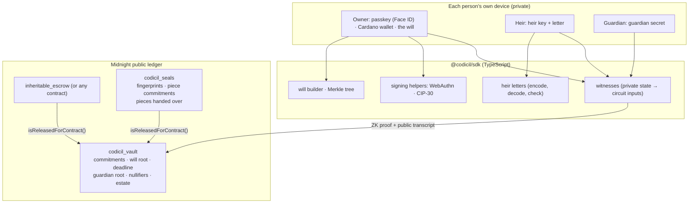
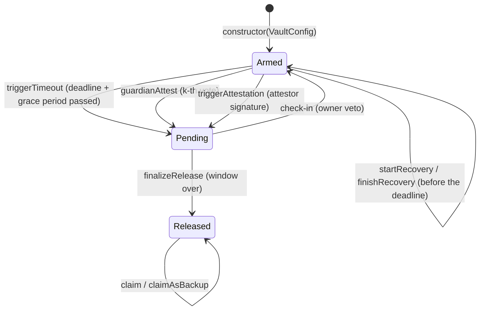
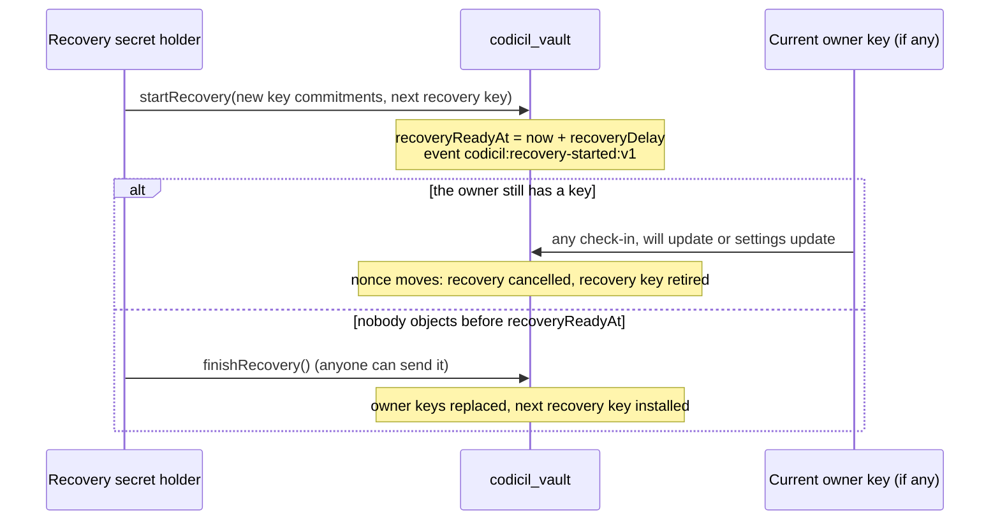

# Architecture

Codicil has three layers: a Compact **contract** that enforces the rules, a TypeScript **SDK** that
holds the private state and builds witnesses, and a React **app** that runs the real contract in the
browser for the demo. This page explains how they fit together. For what is public and what is
private, see [PRIVACY.md](PRIVACY.md); for threats, [THREAT_MODEL.md](THREAT_MODEL.md).



## Repository layout

| Path | Role |
|---|---|
| [`contracts/src/codicil_vault.compact`](../contracts/src/codicil_vault.compact) | The vault: 16 exported circuits, 12 pure helpers |
| [`contracts/src/lib/WebAuthn.compact`](../contracts/src/lib/WebAuthn.compact) | Passkey assertion verification, generic over the site origin's lengths |
| [`contracts/src/lib/Cip30.compact`](../contracts/src/lib/Cip30.compact) | Cardano CIP-30 `signData` verification (COSE_Sign1, plain Ed25519) |
| [`contracts/src/inheritable_escrow.compact`](../contracts/src/inheritable_escrow.compact) | Example integrator using a cross-contract call |
| [`contracts/src/codicil_seals.compact`](../contracts/src/codicil_seals.compact) | The seal register: hands over the pieces of a sealed message's key only after the vault has released ([D21](DECISIONS.md)) |
| [`contracts/test/`](../contracts/test) | Simulator tests; every successful call is also checked against the ZK circuit |
| [`sdk/src/`](../sdk/src) | Keys, commitments, will builder, witnesses, signing, letters, error catalogue |
| [`sdk/src/staged-deploy.ts`](../sdk/src/staged-deploy.ts) | Deploying the vault in stages, resumably; shared by the app and the Preprod script ([D19](DECISIONS.md)) |
| [`app/src/`](../app/src) | Web app: landing page, the guided demo, and live mode on a test network |
| [`app/src/chain/`](../app/src/chain) | The chain boundary both chains implement |
| [`app/src/live/`](../app/src/live) | Live mode: the live chain, the wallet boundary and Lace, the live store, records and backups |
| [`app/scripts/`](../app/scripts) | `npm run live:e2e`: live mode end to end on a real network with a wallet from a seed |
| [`preprod/`](../preprod) | Gate V14: the vault end to end on a real network with Midnight.js and the wallet SDK ([PREPROD.md](PREPROD.md)) |
| [`codicil-spike/`](../codicil-spike) | Phase 0 validation spike, kept as a record ([VALIDATION.md](VALIDATION.md)) |
| [`tools/webauthn-capture/`](../tools/webauthn-capture) | Page that captured the real passkey and wallet signatures used as test fixtures |

## The contract

### State machine



### Ledger

All of it is public. The design goal is that nothing here identifies a person
([PRIVACY.md](PRIVACY.md) explains each field).

| Group | Fields |
|---|---|
| Owner | `ownerPasskeyCommit`, `ownerEdCommit` (salted commitments; zero = that key type disabled), `passkeyRpIdHash` (the website), `nonce` (owner actions so far) |
| Recovery | `recoveryKeyCommit` (zero = no recovery key), `recoveryDelay`; for a recovery that was started: `recoveryReadyAt`, `recoveryNonce` (the owner `nonce` at that moment), `recoveryPasskeyCommit`, `recoveryEdCommit`, `recoveryNextKeyCommit` |
| Will | `willRoot` (Merkle root of the heir entries), `willVersion` |
| Timers | `phase`, `deadline`, `maxPeriod`, `challengeWindow`, `claimWindow`, `gracePeriod` (0 = none), `pendingUntil`, `releasedAt` |
| Estate | `tokenColor`, `estateTotal`, `estateSnapshot` (frozen at release, after the fee), `estatePaid` (capped at the snapshot), `feeBps` and `feeRecipient` (the optional release fee; 0 = none) |
| Claims | `claimNullifiers` (one per claimed will entry) |
| Guardians | `guardianRoot`, `guardianThreshold` (k), `guardianRound`, `guardianVotes`, `guardianNullifiers` |
| Attestor | `attestorKeyCommit` |

### Circuits

| Circuit | Who calls it | Authorisation | Effect |
|---|---|---|---|
| `checkInPasskey(next)` | Owner | WebAuthn assertion over `aliveDigest(vault, next, nonce)`, from the committed passkey, on the committed website, with Face ID / Touch ID | Moves the deadline (at most `maxPeriod` from now), bumps the nonce, voids guardian votes; vetoes a pending switch; cancels a recovery in progress. Allowed until the deadline plus the grace period, and during any challenge window |
| `checkInEd25519(next)` | Owner | CIP-30 signature over the same digest from the committed wallet key | Same |
| `updateWillPasskey(root)` / `updateWillEd25519(root)` | Owner | Signature over `willUpdateDigest(vault, root, nonce)` | Replaces the will root; only while armed and before the deadline. Cancels a recovery in progress. Emits `codicil:will-changed:v1` |
| `updateSettingsPasskey(settings)` / `updateSettingsEd25519(settings)` | Owner | Signature over `settingsDigest(vault, settings, nonce)` | Replaces the guardian root, the threshold and the attestor commitment together; starts a new guardian round; cancels a recovery in progress; only while armed and before the deadline |
| `startRecovery(passkeyCommit, edCommit, nextRecoveryCommit, asOf)` | Whoever holds the recovery secret | Knowledge of the secret behind `recoveryKeyCommit`; fresh timestamp | Proposes new owner keys, effective after `recoveryDelay`; replaces an earlier proposal; emits `codicil:recovery-started:v1`. Only while armed, and only if it can finish before the deadline |
| `finishRecovery()` | Anyone | The delay is over; still armed and before the deadline | Installs the proposed owner keys and the next recovery key |
| `deposit(amount)` | Anyone | None | Receives unshielded tokens while armed |
| `triggerTimeout()` | Anyone | The deadline and the grace period have passed | Starts the challenge window, counted from the end of the grace period |
| `guardianAttest(asOf)` | A guardian | Merkle membership in `guardianRoot`, one nullifier per guardian per round | Counts a vote; the k-th vote starts the challenge window |
| `triggerAttestation(asOf)` | Anyone holding an attestation | P-256 signature from the committed attestor over `attestationDigest(vault, round)` | Starts the challenge window |
| `finalizeRelease()` | Anyone | Challenge window over | Releases; sends the release fee, if one is set; snapshots what remains; emits `codicil:released:v1` |
| `isReleasedForContract()` | Other contracts only | `kernel.caller()` must be a contract | Returns whether the vault is released |
| `claim(to)` | An heir | Merkle membership in `willRoot`, knowledge of the heir key's secret, unlock date reached, unused nullifier | Pays `snapshot × shareBps / 10000` to `to` |
| `claimAsBackup(to)` | A backup heir | Same, with the backup key, and only after `claimWindow` | Pays the same share; shares the nullifier, so heir and backup cannot both be paid |

The 12 exported pure circuits (`passkeyCommitment`, `edKeyCommitment`, `recoveryCommitment`,
`heirLeafHash`, `aliveDigest`, `willUpdateDigest`, `settingsDigest`, `claimNullifier`, `guardianLeaf`, `guardianNullifier`, `attestorCommitment`,
`attestationDigest`) are called by the SDK, so TypeScript never re-implements a hash.

### Grace period

`gracePeriod` is optional ([D15](DECISIONS.md)). When it is set, an owner who misses the deadline can
still check in normally until `deadline + gracePeriod`, and `triggerTimeout` is refused until then, so
a check-in that is a day late does not put the vault into a public countdown. Guardians and the
attestor are not delayed. The will stays locked from the deadline itself. With `gracePeriod = 0` the
vault behaves as it did before the option existed.

### Signing first, proving second

An owner action has two steps ([D10](DECISIONS.md)):

```mermaid
sequenceDiagram
    participant App
    participant Passkey as Passkey (Face ID)
    participant SDK
    participant Vault as codicil_vault
    App->>Vault: read nonce, deadline (public)
    App->>SDK: checkInDigest(vault, next, nonce)
    SDK-->>App: 32-byte digest (from the contract's pure circuit)
    App->>Passkey: navigator.credentials.get(challenge = digest)
    Passkey-->>App: assertion (authenticatorData, clientDataJSON, signature)
    App->>SDK: store the approval in private state
    App->>Vault: checkInPasskey(next) with witnesses
    Note over Vault: verifies commitment, rpIdHash, UV flag,<br/>challenge = digest, P-256 signature
    Vault-->>App: deadline moved; public transcript has no key, salt or signature
```

The circuit rebuilds the WebAuthn message in-circuit. It checks that `clientDataJSON` is a
`webauthn.get` whose base64url challenge decodes to the digest, and that `authenticatorData` carries
the site's `rpIdHash` and the user-present and user-verified (Face ID / Touch ID) flags. It then
hashes `clientDataJSON` with SHA-256, appends that to `authenticatorData`, hashes again and verifies
the P-256 signature. Chrome sometimes lengthens `clientDataJSON`, so
the module accepts both lengths for the origin ([VALIDATION.md](VALIDATION.md) V6). The origin's
lengths are module parameters (`WebAuthn<134, 243>` for `http://localhost:5173`), which is why a
hosted deployment needs a recompile for its own origin ([D12](DECISIONS.md)).

### The will

Each heir entry is a `HeirLeaf { heirKeyCommit, backupKeyCommit, shareBps, unlockAt, salt }`. The SDK
builds a depth-10 Merkle tree (up to 1,024 entries) of `heirLeafHash(leaf)` values; empty slots are
zero. Only the root goes on-chain.

An heir's identity is a Curve25519 key ([D3](DECISIONS.md)). The leaf stores
`edKeyCommitment(publicKey, salt)`. To claim, the heir supplies the secret scalar as a witness and the
circuit recomputes the public key with `ecMulGenerator`, so the claim proves possession of the key
without revealing it.

The payout needs a division, which Compact lacks. The witness supplies quotient and remainder; the
circuit checks `q × 10000 + r == snapshot × bps` and `r < 10000` ([D2](DECISIONS.md)), and that total
payouts never exceed the snapshot.

### Release fee

A vault can be deployed with a release fee ([D16](DECISIONS.md)): `feeBps` basis points of the estate,
at most 10%, sent to `feeRecipient` by `finalizeRelease`. The fee is computed with the same checked
division, rounded down, and the snapshot becomes `estateTotal − fee`. Heirs' shares are taken of that
snapshot, so the payout maths above is unchanged and `fee + all claims ≤ estateTotal`. With
`feeBps = 0` there is no transfer and no witness call, and the snapshot is the whole estate.

### Heir letters

The owner gives each heir a **letter**: `codicil:claim:v1:` followed by 461 bytes in base64url (vault
address, the heir's leaf, its Merkle path). It fits in a QR code. It does not contain the heir's
secret key, which the heir keeps separately, so neither works alone
([`sdk/src/letter.ts`](../sdk/src/letter.ts)).

The heir's device checks a letter using public data only (`checkHeirLetter`): the vault address
matches, the path leads to the current `willRoot` (an old letter fails after the will changes), and
the heir's own key opens the leaf as heir or as backup. Nothing is sent anywhere.

Every will update emits a `codicil:will-changed:v1` event ([D14](DECISIONS.md)). An heir's app that
follows the vault can then re-run the check and tell the heir to ask the owner for a new letter. The
event has no payload: it says that the will changed, never how.

### Guardians and the attestor

A guardian holds a random secret. The guardian root is a Merkle tree of `guardianLeaf(secret)`.
A vote proves membership and publishes `guardianNullifier(vault, secret, round)`, which changes every
round and differs between vaults, so votes cannot be linked to each other or to a guardian. Any
check-in bumps the round, which voids all earlier votes and attestations ([D13](DECISIONS.md)).
Guardians vote in separate transactions to keep each proof small ([D6](DECISIONS.md)).

The owner can replace the guardian root, the threshold and the attestor commitment with a signed
settings update ([D17](DECISIONS.md)). The owner signs the complete new settings, so to change one
value the app starts from `currentSettings(ledger)`. Every settings update starts a new guardian
round: votes cast under the old set or threshold stop counting, and so do attestations signed
before it. A guardian who was kept needs a new Merkle path from the owner; their app can tell with
`isCurrentGuardian`.

### Recovery key

An owner who loses every registered key can get back in with a recovery key ([D18](DECISIONS.md)): 32
random bytes kept offline, with only `recoveryCommitment(secret)` on the ledger.



A recovery stands only while the owner `nonce` is the one recorded when it started. Every owner
action moves the nonce, so cancelling costs the owner circuits nothing, and a key whose recovery was
cancelled can never start another. `recoveryStatus()` in the SDK reads this from the ledger.

The recovery key never touches the switch. It acts only while the vault is armed and before the
deadline; it cannot delay a timeout, veto a countdown, or act once guardians or an attestor have
started one. A recovery that could not finish before the deadline is refused when it starts. With
`recoveryKeyCommit` all zeros there is no recovery key and none of this applies.

### Cross-contract hook

`inheritable_escrow` declares the vault's interface and calls `isReleasedForContract()` before paying
its beneficiary. Any Midnight contract can make a position inheritable this way. Both proofs go in
one transaction ([`escrow.test.ts`](../contracts/test/escrow.test.ts)). The demo's **Savings** tab
runs this for real: the compiled escrow next to the compiled vault, refused before the release and
paid after it. [BUILD_ON_CODICIL.md](BUILD_ON_CODICIL.md) shows the lines to copy.

### The seal register

`codicil_seals` uses the same hook for words instead of money. A sealed message is encrypted off
the chain, and the guardians hold the pieces of half of its key ([D20](DECISIONS.md)). The register
is one of two routes for those pieces ([D21](DECISIONS.md)). It has six circuits:

| Circuit | Who | What it does |
|---|---|---|
| `seal` | The keeper (the owner's device) | Records a fingerprint of the sealed text, how many pieces exist and are needed, a commitment to each piece (eight at most), and a time the seal was recorded before |
| `unseal` | The keeper | Removes a seal. Refused once the vault has released |
| `handOver` | Anyone holding a piece | Asks the vault whether it has released, checks the piece against its commitment, and writes it to the public ledger |
| `state` | The keeper | Records the fingerprint of a public statement, such as a canary |
| `provePasskeyOwner`, `proveWalletOwner` | The keeper, holding the owner's key and salt | Records the vault's own owner commitment, computed from private inputs. A reader who finds the same value on both ledgers knows the vault's owner made this register |

The register never receives a message or a key. A reader collects the pieces from its ledger and
opens the text on their own device. Tests: [`seals.test.ts`](../contracts/test/seals.test.ts). The
demo's **Messages** tab runs the compiled register next to the compiled vault. The network script
has run it on Preview (`--seals`), and the reader page (`#/read`, `app/src/live/reader.ts`) reads a
vault and a register from Preview's indexer with no wallet. Live mode does not create one yet.

## The SDK

| Module | Purpose |
|---|---|
| [`keys.ts`](../sdk/src/keys.ts) | P-256 and Ed25519 keys and salts in the runtime's exact shapes |
| [`webauthn.ts`](../sdk/src/webauthn.ts), [`cip30.ts`](../sdk/src/cip30.ts) | Convert real passkey assertions and wallet `signData` results to circuit inputs |
| [`config.ts`](../sdk/src/config.ts) | Origin, relying party id and the two `clientDataJSON` lengths |
| [`owner.ts`](../sdk/src/owner.ts) | Digests the owner signs (check-in, will, settings), computed by the contract's pure circuits |
| [`will.ts`](../sdk/src/will.ts), [`merkle.ts`](../sdk/src/merkle.ts) | Will builder, Merkle tree and paths, `rootFromPath` |
| [`guardians.ts`](../sdk/src/guardians.ts) | Guardian set and per-guardian paths |
| [`recovery.ts`](../sdk/src/recovery.ts) | Recovery secret, its commitment, config limits and `recoveryStatus()` from public ledger fields |
| [`witnesses.ts`](../sdk/src/witnesses.ts) | `CodicilPrivateState` and the witness functions the circuits call |
| [`letter.ts`](../sdk/src/letter.ts) | Heir letter encoding, decoding, fingerprint and on-device check |
| [`sealed.ts`](../sdk/src/sealed.ts) | Sealed messages: AES-256-GCM, a key in two halves, Shamir's scheme for the guardians' half, the sealed text as text and its fingerprint |
| [`seals.ts`](../sdk/src/seals.ts) | The seal register from outside: arguments for `seal` and `handOver`, piece commitments, reading handed-over pieces from its ledger |
| [`errors.ts`](../sdk/src/errors.ts) | Every contract `assert` message mapped to plain language ([ERRORS.md](ERRORS.md)) |
| [`events.ts`](../sdk/src/events.ts) | Names of the events the vault emits, and `vaultEventName()` to recognise one |

## The app

The app is React + Vite with hand-written CSS tokens (the "Obsidian" design: dark and light themes,
works on phones).

- **Landing page** (`#/`): a scrolling page over a WebGL point field that changes shape with each section.
- **Demo** (`#/demo`): it opens on four stories: leave a will, seal a disclosure, publish a canary,
  make a contract wait for the release. The will runs a nine-step setup wizard. The other three
  start with a vault already made. Then the vault is shown from four points of view: the owner
  (Amara), an heir (Ada, Ben, Cleo, Kofi), a guardian, and "Anyone" (the public inspector). Everyone
  has Savings, Messages and Privacy Lens tabs. The owner also has Will and Settings (guardians,
  attestor and the recovery key).
- **Live mode** (`#/app`): a real vault on a Midnight test network, through the person's own Lace
  wallet. Three ways in: create a vault, open an invitation as an heir or a guardian, or restore a
  backup file. See [Two chains and the wallet boundary](#two-chains-and-the-wallet-boundary).

### What the demo runs

[`app/src/demo/chain.ts`](../app/src/demo/chain.ts) runs the **compiled vault contract** in the
browser against an in-memory ledger with a clock the demo can move forward. Each action executes the
same circuit code and produces the same public transcript a real transaction would. Only proof
generation and network submission are skipped. The passkey is real when the browser supports it:
Face ID / Touch ID signs, and the circuit verifies the signature.

The same chain holds a second compiled contract, `inheritable_escrow` (shown as "Harbour Savings"),
and is the state and module provider for cross-contract calls, so a withdrawal runs the escrow
circuit and, inside it, the vault's `isReleasedForContract` circuit against the vault's current
state. The runtime's cross-contract path uses Node's `Buffer` for hex, so
[`buffer-shim.ts`](../app/src/demo/buffer-shim.ts) supplies those two conversions in the browser.

It holds a third compiled contract, `codicil_seals`, deployed with the vault. Sealing a message
through the register, taking it back, handing over a piece and recording a public statement each
run its circuits, and `handOver` and `unseal` run the vault's `isReleasedForContract` inside them.
The encryption and key splitting are real ([`sdk/src/sealed.ts`](../sdk/src/sealed.ts)). What the
demo simulates is delivery between people: everyone's device is in one browser tab.

A message can carry a file, or be only a file (D22). The file is sealed with
[`sdk/src/sealed-file.ts`](../sdk/src/sealed-file.ts) under its own key, so a message with words and
a file has two seals and two pieces per guardian. The encrypted body goes to a `memoryBlobStore` the
demo store holds (in live mode, the test network's storage); the reader holds the pointer. Once
enough pieces are in, the reader's view calls `openFile`, which collects them (from the register's
ledger with `piecesHandedOver`, or the ones handed over by hand), fetches the body, checks its length
and SHA-256, rebuilds the key, decrypts, and offers the file as a Blob URL download. A guardian's
view opened after the release calls `autoHandOver`: it sends every piece that guardian still holds
(by hand, or through the register in the transaction sheet), once per guardian, and nothing before
the release. The manual buttons stay as a fallback.

[`app/src/demo/store.ts`](../app/src/demo/store.ts) holds the world (chain, keys, will, letters held
by heirs, the proof each guardian holds, the saved recovery key) and exposes it to React through
`useSyncExternalStore`. Every action goes through a
transaction sheet with the real stages (prepare, approve, run the circuit, proof, record), so a
failure shows where it happened and in plain words.

The store deploys with the release fee off and the owner's choice of grace period and recovery key
(`VAULT_OPTIONS_OFF`, `recoveryConfig`). What the screens show about them comes from the SDK and the
ledger, not from the store's memory: `timeoutOpensAt` for when the switch can start,
`recoveryStatus` for the recovery key, `isCurrentGuardian` for each guardian's own proof, and the
events each call emitted (`vaultEventName`), which is how an heir's page learns that a will changed.
A settings update is signed like a check-in (`settingsDigest`); a recovery makes a new passkey, as a
new device would, and installs it only when `finishRecovery` succeeds.

Pure helpers keep the views simple and testable:
[`guide.ts`](../app/src/demo/guide.ts) (who acts next, on time / in grace / expired, what to try on the savings screen, the will in plain words, presets),
[`recoveryKey.ts`](../app/src/demo/recoveryKey.ts) (the recovery key as text with a check for typing mistakes),
[`commands.ts`](../app/src/demo/commands.ts) (the ⌘K palette),
[`ics.ts`](../app/src/demo/ics.ts) (calendar reminders made on the device).

### Two chains and the wallet boundary

The app runs the same contract in two places, and one small interface sits between the app and
whichever it is on ([`app/src/chain/types.ts`](../app/src/chain/types.ts)):

```
VaultChain   one vault: its address, its public ledger, the chain's time,
             call(circuit, privateState, ...args), refresh(), subscribe()
VaultHost    where vaults live: createVault(config, { resume, onRecord }), openVault(address)
```

| | In-memory chain (`#/demo`) | Live chain (`#/app`) |
|---|---|---|
| Code | [`demo/chain.ts`](../app/src/demo/chain.ts) | [`live/live-chain.ts`](../app/src/live/live-chain.ts) |
| Public state | A map in this tab | The network's indexer, read again every 12 s while a vault is open |
| A call | The circuit runs once, in WebAssembly | The circuit runs, a proof server proves it, the wallet pays the fee and signs, a node includes it |
| Time | A clock the demo moves | Real time. The app waits 30 s past a deadline before offering what the deadline unlocks, because a network's clock trails the browser's |
| Creating a vault | One step | Eight transactions, resumable ([D19](DECISIONS.md)) |

A store written against the interface does not know which one it has. The live store
([`live/store.ts`](../app/src/live/store.ts)) is unit-tested on the in-memory chain and runs
unchanged on a network. It is a separate store from the demo's because a real person differs from a
guided tour: the heirs and guardians are the ones the owner types in, there is no "act as" and no
clock control, and every secret is in a record that survives a reload.

**The live chain** is Midnight.js 5.0.1: the indexer public-data provider,
a client for the proof server, and the wallet for balancing and submitting. The circuit artifacts are fetched over HTTP from
`/zk/codicil_vault/` ([`zk-server.ts`](../app/zk-server.ts) serves `contracts/managed/codicil_vault`
in the dev and preview servers). A proving key is up to 448 MB, so downloads report progress and
finished ones are kept in the browser's Cache Storage until the file changes
([`live/zk-artifacts.ts`](../app/src/live/zk-artifacts.ts)). Private state is not kept by
Midnight.js: the store hands each call exactly the secrets it needs.

**Proofs** are requested by the app's own client for the proof server
([`live/prover.ts`](../app/src/live/prover.ts)), not Midnight.js's. The proof server is sent the
circuit's proving key with every request, and Midnight.js's client fetches the key twice per proof,
copies it into the ledger's WebAssembly memory and back out, and copies the request once more:
several times 448 MB for a passkey check-in, which a browser tab did not survive. The app's client
sends the same bytes with the key as a Blob that points at the browser's cached copy, so the key
never becomes an array in the page. The body is built around the key by hand and checked byte for
byte against the ledger's `createProvingPayload` in the tests. It has not yet made a proof on a
network ([VALIDATION.md](VALIDATION.md#live-mode-on-a-network-2026-11-26)).

**The wallet boundary** ([`live/wallet.ts`](../app/src/live/wallet.ts)) is five things: which
services to use, the person's address, their balances, "balance and sign this transaction", and
"submit it". Transactions cross as bytes. There are two implementations:

- [`live/lace.ts`](../app/src/live/lace.ts): the Lace extension through the Midnight DApp connector
  (API 4.1.0, `window.midnight`). The network id and the indexer, node and proof-server addresses
  come from the wallet's own configuration, so the app holds no endpoint and no provider token, and
  works on whichever test network the wallet is on (Preview or Preprod).
- [`scripts/headless-wallet.ts`](../app/scripts/headless-wallet.ts): a wallet built from a seed with
  the wallet SDK, sharing its code with the Preprod script. `npm run live:e2e` uses it to drive the
  live store and the live chain end to end on a real network with nobody clicking.

**What the browser keeps** ([`live/records.ts`](../app/src/live/records.ts),
[`live/keyring.ts`](../app/src/live/keyring.ts), [D22](DECISIONS.md)): one record per vault the
person owns, inherits from or guards, tagged with its network, all encrypted (AES-256-GCM) under
`recordsKeyFromRoot(root)`. The root is the person's identity root, made on first use and kept in a
keyring beside the records. The keyring always has a **recovery-code** slot (26 characters and a
check character, shown once and typed back) and, where the browser and passkey provider support the
WebAuthn PRF extension, a **passkey** slot ([`live/prf.ts`](../app/src/live/prf.ts)); the owner's
passkey is one credential that both opens the keyring and signs check-ins. Without PRF the code
opens it each time. A **wallet** slot is offered only for a wallet whose `signData` gives the same
signature twice. Until the keyring is opened the store holds no records; plain records from before
are locked on first set-up.

An owner's record holds the will and its salts and the vault's maintenance key. The vault's
**recovery secret** is not stored: it is `deriveFromRoot(root, "vault-recovery:<record id>")`, and
every live vault is created with its commitment, so the printed code (through the backup file on a
new device) can replace a lost passkey after the recovery delay. Heirs and guardians **make their
own keys**: the owner sends an invitation with no secret; the invitee's browser derives their heir
key, salt, guardian secret and X25519 box key from their own root and the invitation id, and replies
with the key commitment (or guardian leaf) and the box public key. After deployment the owner seals
each person's heir letter or guardian path to that key (`sealTo`), so it can travel any way. The
invitee's record holds no key that cannot be rebuilt from their root. The older kit flow, where the
owner's device makes the keys and the invitation carries them, remains as "make their keys for them".

A backup file is the keyring and the encrypted records: no passphrase, and whatever opens the
keyring opens it. Older passphrase files (PBKDF2-SHA-256) still import. Restored into a browser
with its own keyring, records keep the root they came with. A device passkey's private key is never
in a record or a backup: it stays in the authenticator.

**Creating a vault in stages.** The record, with every key, is saved before anything is sent. The
vault's address and maintenance key are saved before the deploy transaction is sent (the address is
known in advance). After an interruption the app asks the indexer which circuits the contract has
and adds only the missing ones (`missingCircuits` in
[`sdk/src/staged-deploy.ts`](../sdk/src/staged-deploy.ts), which the Preprod script shares).

**When something goes wrong**, [`live/problems.ts`](../app/src/live/problems.ts) turns it into a
title, what happened and what to do: no wallet, a wallet on another network, no tNIGHT (with the
right faucet), no DUST yet, no proof server (with the command), a declined approval, a transaction a
node refused (with the node's own reason), a dropped connection.

Limits of live mode today are listed in the [roadmap](ROADMAP.md#live-mode-what-it-does-not-do-yet).
