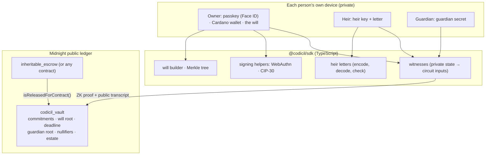
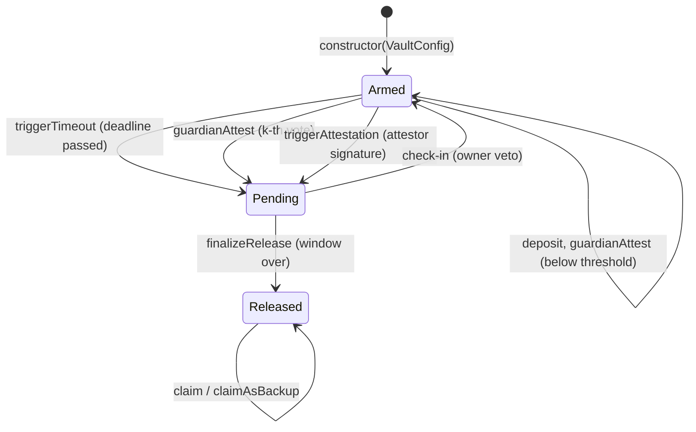

# Architecture

Codicil has three layers: a Compact **contract** that enforces the rules, a TypeScript **SDK** that
holds the private state and builds witnesses, and a React **app** that runs the real contract in the
browser for the demo. This page explains how they fit together. For what is public and what is
private, see [PRIVACY.md](PRIVACY.md); for threats, [THREAT_MODEL.md](THREAT_MODEL.md).



## Repository layout

| Path | Role |
|---|---|
| [`contracts/src/codicil_vault.compact`](../contracts/src/codicil_vault.compact) | The vault: 12 exported circuits, 10 pure helpers |
| [`contracts/src/lib/WebAuthn.compact`](../contracts/src/lib/WebAuthn.compact) | Passkey assertion verification, generic over the site origin's lengths |
| [`contracts/src/lib/Cip30.compact`](../contracts/src/lib/Cip30.compact) | Cardano CIP-30 `signData` verification (COSE_Sign1, plain Ed25519) |
| [`contracts/src/inheritable_escrow.compact`](../contracts/src/inheritable_escrow.compact) | Example integrator using a cross-contract call |
| [`contracts/test/`](../contracts/test) | Simulator tests; every successful call is also checked against the ZK circuit |
| [`sdk/src/`](../sdk/src) | Keys, commitments, will builder, witnesses, signing, letters, error catalogue |
| [`app/src/`](../app/src) | Web app: landing page, setup wizard, owner / heir / guardian / public views, Privacy Lens |
| [`preprod/`](../preprod) | Gate V14: the vault end to end on a real network with Midnight.js and the wallet SDK ([PREPROD.md](PREPROD.md)) |
| [`codicil-spike/`](../codicil-spike) | Phase 0 validation spike, kept as a record ([VALIDATION.md](VALIDATION.md)) |
| [`tools/webauthn-capture/`](../tools/webauthn-capture) | Page that captured the real passkey and wallet signatures used as test fixtures |

## The contract

### State machine



### Ledger

All of it is public. The design goal is that nothing here identifies a person
([PRIVACY.md](PRIVACY.md) explains each field).

| Group | Fields |
|---|---|
| Owner | `ownerPasskeyCommit`, `ownerEdCommit` (salted commitments; zero = that key type disabled), `passkeyRpIdHash` (the website), `nonce` (owner actions so far) |
| Will | `willRoot` (Merkle root of the heir entries), `willVersion` |
| Timers | `phase`, `deadline`, `maxPeriod`, `challengeWindow`, `claimWindow`, `pendingUntil`, `releasedAt` |
| Estate | `tokenColor`, `estateTotal`, `estateSnapshot` (frozen at release), `estatePaid` (capped at the snapshot) |
| Claims | `claimNullifiers` (one per claimed will entry) |
| Guardians | `guardianRoot`, `guardianThreshold` (k), `guardianRound`, `guardianVotes`, `guardianNullifiers` |
| Attestor | `attestorKeyCommit` |

### Circuits

| Circuit | Who calls it | Authorisation | Effect |
|---|---|---|---|
| `checkInPasskey(next)` | Owner | WebAuthn assertion over `aliveDigest(vault, next, nonce)`, from the committed passkey, on the committed website, with Face ID / Touch ID | Moves the deadline (at most `maxPeriod` from now), bumps the nonce, voids guardian votes; vetoes a pending switch |
| `checkInEd25519(next)` | Owner | CIP-30 signature over the same digest from the committed wallet key | Same |
| `updateWillPasskey(root)` / `updateWillEd25519(root)` | Owner | Signature over `willUpdateDigest(vault, root, nonce)` | Replaces the will root; only while armed and before the deadline |
| `deposit(amount)` | Anyone | None | Receives unshielded tokens while armed |
| `triggerTimeout()` | Anyone | Deadline has passed | Starts the challenge window |
| `guardianAttest(asOf)` | A guardian | Merkle membership in `guardianRoot`, one nullifier per guardian per round | Counts a vote; the k-th vote starts the challenge window |
| `triggerAttestation(asOf)` | Anyone holding an attestation | P-256 signature from the committed attestor over `attestationDigest(vault, round)` | Starts the challenge window |
| `finalizeRelease()` | Anyone | Challenge window over | Releases; snapshots the estate; emits `codicil:released:v1` |
| `isReleasedForContract()` | Other contracts only | `kernel.caller()` must be a contract | Returns whether the vault is released |
| `claim(to)` | An heir | Merkle membership in `willRoot`, knowledge of the heir key's secret, unlock date reached, unused nullifier | Pays `snapshot × shareBps / 10000` to `to` |
| `claimAsBackup(to)` | A backup heir | Same, with the backup key, and only after `claimWindow` | Pays the same share; shares the nullifier, so heir and backup cannot both be paid |

The 10 exported pure circuits (`passkeyCommitment`, `edKeyCommitment`, `heirLeafHash`, `aliveDigest`,
`willUpdateDigest`, `claimNullifier`, `guardianLeaf`, `guardianNullifier`, `attestorCommitment`,
`attestationDigest`) are called by the SDK, so TypeScript never re-implements a hash.

### Signing first, proving second

An owner action has two steps ([D10](DECISIONS.md)):

```mermaid
sequenceDiagram
    participant App
    participant Passkey as Passkey (Face ID)
    participant SDK
    participant Vault as codicil_vault
    App->>Vault: read nonce, deadline (public)
    App->>SDK: checkInDigest(vault, next, nonce)
    SDK-->>App: 32-byte digest (from the contract's pure circuit)
    App->>Passkey: navigator.credentials.get(challenge = digest)
    Passkey-->>App: assertion (authenticatorData, clientDataJSON, signature)
    App->>SDK: store the approval in private state
    App->>Vault: checkInPasskey(next) with witnesses
    Note over Vault: verifies commitment, rpIdHash, UV flag,<br/>challenge = digest, P-256 signature
    Vault-->>App: deadline moved; public transcript has no key, salt or signature
```

The circuit rebuilds the WebAuthn message in-circuit. It checks that `clientDataJSON` is a
`webauthn.get` whose base64url challenge decodes to the digest, and that `authenticatorData` carries
the site's `rpIdHash` and the user-present and user-verified (Face ID / Touch ID) flags. It then
hashes `clientDataJSON` with SHA-256, appends that to `authenticatorData`, hashes again and verifies
the P-256 signature. Chrome sometimes lengthens `clientDataJSON`, so
the module accepts both lengths for the origin ([VALIDATION.md](VALIDATION.md) V6). The origin's
lengths are module parameters (`WebAuthn<134, 243>` for `http://localhost:5173`), which is why a
hosted deployment needs a recompile for its own origin ([D12](DECISIONS.md)).

### The will

Each heir entry is a `HeirLeaf { heirKeyCommit, backupKeyCommit, shareBps, unlockAt, salt }`. The SDK
builds a depth-10 Merkle tree (up to 1,024 entries) of `heirLeafHash(leaf)` values; empty slots are
zero. Only the root goes on-chain.

An heir's identity is a Curve25519 key ([D3](DECISIONS.md)). The leaf stores
`edKeyCommitment(publicKey, salt)`. To claim, the heir supplies the secret scalar as a witness and the
circuit recomputes the public key with `ecMulGenerator`, so the claim proves possession of the key
without revealing it.

The payout needs a division, which Compact lacks. The witness supplies quotient and remainder; the
circuit checks `q × 10000 + r == snapshot × bps` and `r < 10000` ([D2](DECISIONS.md)), and that total
payouts never exceed the snapshot.

### Heir letters

The owner gives each heir a **letter**: `codicil:claim:v1:` followed by 461 bytes in base64url (vault
address, the heir's leaf, its Merkle path). It fits in a QR code. It does not contain the heir's
secret key, which the heir keeps separately, so neither works alone
([`sdk/src/letter.ts`](../sdk/src/letter.ts)).

The heir's device checks a letter using public data only (`checkHeirLetter`): the vault address
matches, the path leads to the current `willRoot` (an old letter fails after the will changes), and
the heir's own key opens the leaf as heir or as backup. Nothing is sent anywhere.

### Guardians and the attestor

A guardian holds a random secret. The guardian root is a Merkle tree of `guardianLeaf(secret)`.
A vote proves membership and publishes `guardianNullifier(vault, secret, round)`, which changes every
round and differs between vaults, so votes cannot be linked to each other or to a guardian. Any
check-in bumps the round, which voids all earlier votes and attestations ([D13](DECISIONS.md)).
Guardians vote in separate transactions to keep each proof small ([D6](DECISIONS.md)).

### Cross-contract hook

`inheritable_escrow` declares the vault's interface and calls `isReleasedForContract()` before paying
its beneficiary. Any Midnight contract can make a position inheritable this way. Both proofs go in
one transaction ([`escrow.test.ts`](../contracts/test/escrow.test.ts)).

## The SDK

| Module | Purpose |
|---|---|
| [`keys.ts`](../sdk/src/keys.ts) | P-256 and Ed25519 keys and salts in the runtime's exact shapes |
| [`webauthn.ts`](../sdk/src/webauthn.ts), [`cip30.ts`](../sdk/src/cip30.ts) | Convert real passkey assertions and wallet `signData` results to circuit inputs |
| [`config.ts`](../sdk/src/config.ts) | Origin, relying party id and the two `clientDataJSON` lengths |
| [`owner.ts`](../sdk/src/owner.ts) | Digests the owner signs, computed by the contract's pure circuits |
| [`will.ts`](../sdk/src/will.ts), [`merkle.ts`](../sdk/src/merkle.ts) | Will builder, Merkle tree and paths, `rootFromPath` |
| [`guardians.ts`](../sdk/src/guardians.ts) | Guardian set and per-guardian paths |
| [`witnesses.ts`](../sdk/src/witnesses.ts) | `CodicilPrivateState` and the witness functions the circuits call |
| [`letter.ts`](../sdk/src/letter.ts) | Heir letter encoding, decoding, fingerprint and on-device check |
| [`errors.ts`](../sdk/src/errors.ts) | Every contract `assert` message mapped to plain language ([ERRORS.md](ERRORS.md)) |

## The app

The app is React + Vite with hand-written CSS tokens (the "Obsidian" design: dark and light themes,
works on phones).

- **Landing page** (`#/`): a scrolling page over a WebGL point field that changes shape with each section.
- **Demo** (`#/demo`): a seven-step setup wizard, then the vault from four points of view: the
  owner (Amara), an heir (Ada, Ben, Cleo, Kofi), a guardian, and "Anyone" (the public inspector).

### What the demo runs

[`app/src/demo/chain.ts`](../app/src/demo/chain.ts) runs the **compiled vault contract** in the
browser against an in-memory ledger with a clock the demo can move forward. Each action executes the
same circuit code and produces the same public transcript a real transaction would. Only proof
generation and network submission are skipped. The passkey is real when the browser supports it:
Face ID / Touch ID signs, and the circuit verifies the signature.

[`app/src/demo/store.ts`](../app/src/demo/store.ts) holds the world (chain, keys, will, letters held
by heirs) and exposes it to React through `useSyncExternalStore`. Every action goes through a
transaction sheet with the real stages (prepare, approve, run the circuit, proof, record), so a
failure shows where it happened and in plain words.

Pure helpers keep the views simple and testable:
[`guide.ts`](../app/src/demo/guide.ts) (who acts next, the will in plain words, presets),
[`commands.ts`](../app/src/demo/commands.ts) (the ⌘K palette),
[`ics.ts`](../app/src/demo/ics.ts) (calendar reminders made on the device).

### From demo to network

Going live replaces the in-memory chain with Midnight.js providers (wallet, proof server, indexer)
and keeps the SDK, witnesses and views. That step is gate V14 ([VALIDATION.md](VALIDATION.md)) and
is next on the [roadmap](ROADMAP.md). The provider wiring already exists for a command-line run
([`preprod/src/providers.ts`](../preprod/src/providers.ts), [PREPROD.md](PREPROD.md)).
